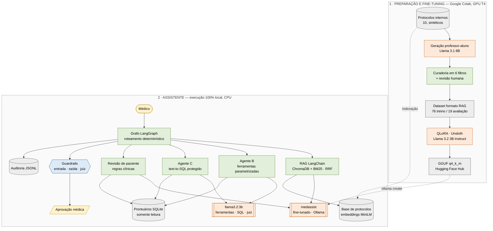
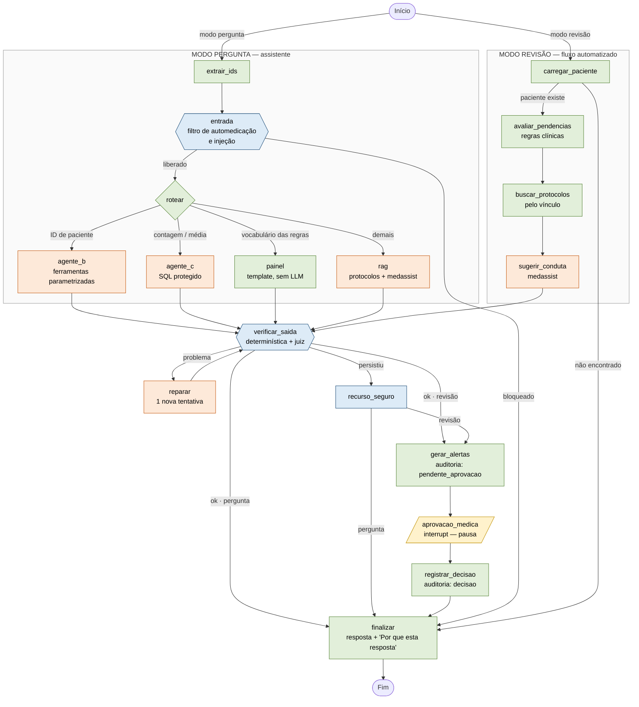

# Diagramas do sistema

Fontes Mermaid dos diagramas do relatório técnico (renderizam direto no GitHub).
As versões em PNG estão em `reports/diagramas/`.

## Figura 1 — Arquitetura geral

Laranja: etapas com LLM · verde: processamento determinístico · azul: guardrails · amarelo: humano · cinza: dados.

## Figura 2 — Fluxo do grafo LangGraph

Gerado a partir do grafo real (`src/grafo.py --diagrama` exporta a versão crua em `reports/grafo.mmd`); esta versão acrescenta os rótulos das arestas condicionais.

